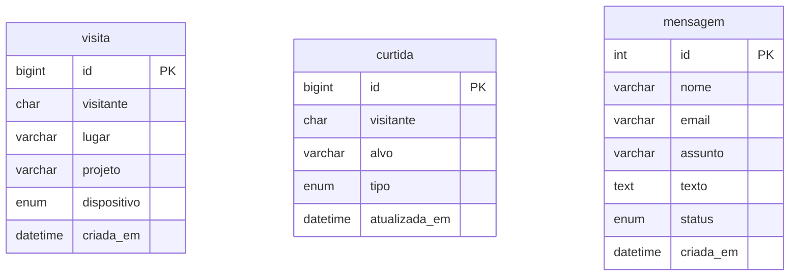

# Banco de dados do Mundo Swarttz (MySQL)

> **Status:** documentação e script de criação prontos (`database/criar_banco.sql`). A API e o painel ainda não foram escritos; eles vêm depois, seguindo este documento.

---

## 1. Visão

O conteúdo do site (projetos, formações, depoimentos, contatos) continua escrito no `js/config.js`. É de lá que o mundo 3D e a versão simples (`scripts/build-simples.js`) leem tudo, e cada mudança passa pelo PR, pelos testes e pelo lançamento automático de versão.

O banco MySQL guarda só o que um site estático **não consegue** guardar sozinho, porque vem de quem visita:

1. **Contador de visitas:** o site registra, sem identificar ninguém, quantas pessoas visitaram e quais lugares do mundo 3D e quais projetos foram mais abertos.
2. **Curtir e descurtir:** quem visita pode curtir ou descurtir cada projeto (e o site todo). O número de curtidas aparece para todos; o de descurtidas, só no painel.
3. **Formulário de contato:** quem visita manda uma mensagem pelo site; ela fica guardada no banco e aparece no painel.

Um **painel admin**, de uso só da Gabriella, mostra esses números e as mensagens.

O mundo 3D continua funcionando mesmo se o servidor estiver fora do ar: o conteúdo nunca dependeu do banco, e as curtidas simplesmente aparecem quando o servidor responde.

---

## 2. Requisitos

### Funcionais (o que o sistema faz)

| Código | Requisito |
|---|---|
| RF01 | A administradora entra no painel com e-mail e senha. |
| RF02 | Cada lugar aberto no mundo 3D (cinema, biblioteca, cartas…) gera um registro de visita; no cinema, o registro diz qual projeto foi aberto. |
| RF03 | O painel mostra visitas por dia, visitantes únicos, lugares e projetos mais abertos, e celular × computador. |
| RF04 | O visitante curte ou descurte **cada projeto** e o **site todo**: um voto por alvo, que ele pode trocar ou desfazer. |
| RF05 | O site mostra o **número de curtidas**. O número de descurtidas aparece **só no painel**. |
| RF06 | O visitante envia uma mensagem pelo formulário de contato (nome, e-mail, assunto, mensagem). |
| RF07 | No painel, as mensagens aparecem como **nova**, **lida** ou **respondida**. |

### Não funcionais (como o sistema deve ser)

| Código | Requisito |
|---|---|
| RNF01 | **Privacidade (LGPD):** o contador de visitas e as curtidas não guardam IP, nome nem e-mail. O visitante é um código aleatório criado no navegador. |
| RNF02 | A senha do painel é guardada só como **hash** (bcrypt), nunca em texto. |
| RNF03 | O formulário de contato tem proteção contra robôs (campo-armadilha e limite de envios por minuto). |
| RNF04 | O site continua abrindo e mostrando todo o conteúdo mesmo com o servidor ou o banco fora do ar. |
| RNF05 | A senha do banco e o login do painel nunca vão para o GitHub: ficam em variáveis de ambiente do servidor. |
| RNF06 | Hospedagem com custo zero: API no **Render** (plano grátis) e banco no **TiDB Cloud Starter** (grátis, compatível com MySQL). |

---

## 3. Arquitetura

```
 Navegador ──► GitHub Pages (site: index.html, simples.html, admin.html)
     │            conteúdo lido do js/config.js
     │
     └──► API (Node.js + Express, no Render) ──► TiDB Cloud Starter (MySQL)
          rotas /api/...                         (3 tabelas da seção 4)
```

- **Site:** continua no GitHub Pages, com o conteúdo no `config.js`. Ganha uma página nova, `admin.html` (o painel).
- **API:** um servidor pequeno que é o **único** que conversa com o banco. O navegador nunca acessa o MySQL direto, porque isso exporia a senha do banco.
- **Banco:** TiDB Cloud Starter, que fala a mesma língua do MySQL (mesmos comandos SQL, mesmo MySQL Workbench).
- **Login do painel:** como só a Gabriella entra, o e-mail e o hash da senha ficam em duas variáveis de ambiente do Render (`ADMIN_EMAIL` e `ADMIN_SENHA_HASH`). Não existe tabela de usuários.

**O servidor "dorme" (plano grátis do Render).** Depois de 15 minutos sem ninguém usar, ele desliga e leva cerca de 1 minuto para acordar. Na prática:

- O mundo 3D abre na hora, com todo o conteúdo, porque ele vem do `config.js`.
- As visitas e curtidas do primeiro visitante depois de uma pausa são enviadas quando o servidor acordar (o site tenta de novo sozinho).
- Até o servidor acordar, os números de curtidas podem aparecer com atraso.
- O painel admin mostra "acordando o servidor…" enquanto espera.

---

## 4. Tabelas

São três tabelas independentes. Nenhuma aponta para outra: os projetos e os lugares são identificados pelo mesmo `id` curto que eles têm no `config.js` (ex.: `pixelinha`, `cinema`), e a API confere se o `id` existe antes de gravar.



`PK` é a **chave primária** (o `id` que identifica cada linha). O detalhe de cada coluna está em [`database/dicionario_dados.md`](../database/dicionario_dados.md).

### 4.1 `visita`: contador de visitas

Cada linha é **um lugar aberto** por um visitante. "Visitantes únicos" = quantos `visitante` diferentes existem.

| Coluna | Tipo | Regra | Para que serve |
|---|---|---|---|
| id | BIGINT | PK, auto incremento | identifica o registro |
| visitante | CHAR(36) | obrigatório | código aleatório do navegador (não identifica a pessoa) |
| lugar | VARCHAR(20) | obrigatório | `chegada`, `cinema`, `biblioteca`, `cartas`, `telefone`, `sobre`… |
| projeto | VARCHAR(30) | pode ficar vazio | `id` do filme aberto no cinema (ex.: `pixelinha`); vazio nos outros lugares |
| dispositivo | ENUM('celular','computador','tablet') | | tipo de tela |
| criada_em | DATETIME | padrão agora | quando |

### 4.2 `curtida`: curtir e descurtir

Cada linha é **o voto de um visitante** em um alvo. O `alvo` é o `id` do projeto (ex.: `pixelinha`) ou a palavra `site`, para o voto no site todo. Se o visitante troca de ideia, a linha é atualizada; se desfaz, a linha é apagada.

| Coluna | Tipo | Regra | Para que serve |
|---|---|---|---|
| id | BIGINT | PK, auto incremento | identifica o voto |
| visitante | CHAR(36) | obrigatório | código aleatório do navegador |
| alvo | VARCHAR(30) | obrigatório | `id` do projeto votado, ou `site` |
| tipo | ENUM('curtir','descurtir') | obrigatório | o voto |
| atualizada_em | DATETIME | atualiza sozinho | quando votou ou trocou |

Regra: **(visitante, alvo) é único**. Isso impede o mesmo navegador de votar duas vezes no mesmo alvo.

### 4.3 `mensagem`: formulário de contato

| Coluna | Tipo | Regra | Para que serve |
|---|---|---|---|
| id | INT | PK, auto incremento | identifica a mensagem |
| nome | VARCHAR(80) | obrigatório | quem mandou |
| email | VARCHAR(120) | obrigatório | para responder |
| assunto | VARCHAR(120) | | |
| texto | TEXT | obrigatório | a mensagem |
| status | ENUM('nova','lida','respondida') | padrão 'nova' | controle no painel |
| criada_em | DATETIME | padrão agora | quando chegou |

---

## 5. Perfis de acesso

| Perfil | O que vê | O que pode fazer | O que é restrito |
|---|---|---|---|
| **admin** (Gabriella) | Contador de visitas, curtidas **e descurtidas**, mensagens com e-mail | Marcar mensagens como lidas ou respondidas e apagar mensagens | Nada no sistema |
| **visitante** (público, sem login) | Todo o conteúdo do site e o número de curtidas | Enviar mensagem pelo formulário; curtir, descurtir ou desfazer; gerar registros de visita sem perceber | Painel, mensagens, descurtidas, contador de visitas |

---

## 6. Dados de exemplo

Três linhas de exemplo em cada tabela.

**Tabela `visita`**

| id | visitante | lugar | projeto | dispositivo |
|---|---|---|---|---|
| 1 | a1b2c3 | chegada | | celular |
| 2 | a1b2c3 | cinema | pixelinha | celular |
| 3 | f9e8d7 | cinema | mundo | computador |

**Tabela `curtida`**

| id | visitante | alvo | tipo |
|---|---|---|---|
| 1 | a1b2c3 | site | curtir |
| 2 | a1b2c3 | pixelinha | curtir |
| 3 | f9e8d7 | pixelinha | descurtir |

**Tabela `mensagem`**

| id | nome | email | status |
|---|---|---|---|
| 1 | Carla Dias | carla@exemplo.com | respondida |
| 2 | Diego Melo | diego@exemplo.com | lida |
| 3 | Elisa Rocha | elisa@exemplo.com | nova |

Os códigos de visitante aparecem curtos só para facilitar a leitura (no banco eles têm 36 caracteres). Os e-mails `@exemplo.com` são inventados de propósito, para não expor o contato real de ninguém.

---

## 7. Decisões tomadas

| Decisão | Escolha | Por quê |
|---|---|---|
| Onde fica o conteúdo | **No `js/config.js`, fora do banco** | O `config.js` guarda coisas que um banco não modelaria bem (cores dos cartazes, prints do telão, assuntos dos livros, saudação das cartas). Com o conteúdo nos dois lugares, haveria duas fontes de verdade para manter iguais. E, com o servidor dormindo, o conteúdo do banco chegaria cerca de 1 minuto depois, trocando os textos na frente do visitante. O conteúdo muda pouco e já tem um fluxo seguro: PR, testes e lançamento automático. |
| Banco só com dados dos visitantes | **3 tabelas: `visita`, `curtida`, `mensagem`** | São as únicas informações que nascem no navegador de quem visita e precisam de um servidor para serem guardadas. |
| Login do painel | **Variáveis de ambiente, sem tabela de usuários** | Só a Gabriella entra no painel. Uma tabela com perfis e permissões teria sempre uma linha só. |
| Comentários | **Fora do projeto** | O formulário de contato já cobre o feedback de quem visita, sem precisar de moderação. |
| Sem chaves estrangeiras | **Projetos identificados pelo `id` do `config.js`** | Como os projetos não estão no banco, não há tabela para a chave estrangeira apontar. A API confere o `id` antes de gravar. |
| Curtidas numa tabela só | **`curtida` com a coluna `alvo`** | O voto no site todo e o voto em cada projeto têm as mesmas colunas; `alvo = 'site'` diferencia os dois. Cada linha continua com um valor só por coluna, e a regra de um voto por alvo vira um `UNIQUE (visitante, alvo)`. |
| Onde roda o banco | **TiDB Cloud Starter** | Grátis, sem cartão, compatível com MySQL. O plano grátis de MySQL puro da Aiven foi encerrado para novos bancos. |
| Onde roda a API | **Render** (grátis) | O painel é de uso da própria Gabriella, e o visitante passa um tempo andando antes de usar o formulário. O atraso de "acordar" afeta só o contador e as curtidas, o que é aceitável. |

---

## 8. Próximas fases

1. **Fase 1 (este documento e `database/criar_banco.sql`):** visão, requisitos, tabelas e perfis.
2. **Fase 2:** criar as contas de hospedagem, as tabelas no TiDB e a API com as rotas.
3. **Fase 3:** painel admin (`admin.html`), formulário de contato e botões de curtir.
4. **Fase 4:** o mundo 3D e a versão simples passam a registrar visitas e mostrar as curtidas.
